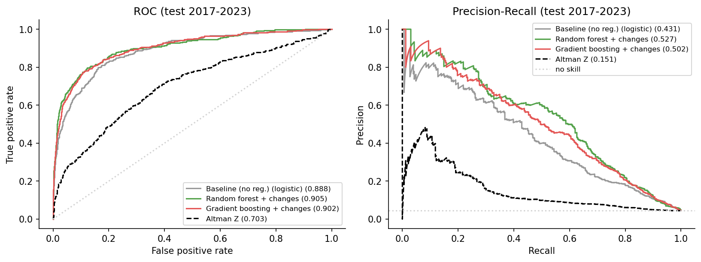

# Cullen Wyatt – Data Science Projects

Chemical Engineering, University of Florida

---

## Predicting Corporate Financial Distress from Financial Statements

**The question.** Using only what a company has already reported this year, can we predict which companies will be in financial distress next year?

A company counts as **distressed** if its operating profit doesn't cover its interest payments *and* it is either burning cash from operations or owes more than it owns.

**The data.** I built the dataset myself from LSEG (Refinitiv) through its API: 17,164 company-years for 1,908 non-financial members of the S&P 500, 400 and 600, from 2007 to 2023. Today's index lists contain only the survivors, so I rebuilt each year's membership from historical index changes. This brings back 1,328 companies that were later acquired, delisted or went bankrupt. Only about 3.6% of company-years end in distress, so the classes are heavily imbalanced.

**What I did.**
1. Built 14 financial ratios covering profitability, leverage, liquidity, cash flow and size, plus how key ratios changed from the previous year
2. Trained logistic regression (plain, L1 and L2), random forest and gradient boosting models, weighting the rare distress cases more heavily
3. Tuned every model on 2007–2016 only, validating each year on earlier years, and tested once on 2017–2023, which no model had seen
4. Compared against two benchmarks: the classic Altman Z-score (1968) and "distressed next year if distressed now"

**What I found.**

| Held-out test, 2017–2023 | Altman Z-score | Logistic regression | Random forest |
|---|---|---|---|
| ROC-AUC (ranking quality, 1.0 = perfect) | 0.703 | 0.888 | **0.905** |
| Distressed firms caught by reviewing the riskiest 5% each year | 25% | 48% | **57%** |

- A random forest beat both logistic regression and the Altman Z-score. The biggest gain was among the highest-risk firms: about half of the companies it flags are actually distressed the next year.
- Interest coverage and operating profitability matter most. The year-over-year change features added little.
- Spotting trouble in companies that look healthy today is still hard (ROC-AUC 0.83). Most of the predictive power comes from firms already showing stress.

**Limitations.** Distress is defined from financial ratios rather than actual bankruptcy filings, so predicting it from ratios is partly circular. Large index companies rarely fail, so there are only 329 distressed cases in the test period.

### Notebook
- [Building the model](https://github.com/cwyatt-uf/cwyatt-uf.github.io/blob/main/notebooks/Distress_Prediction_Notebook.ipynb)

---

## About me

Fourth-year chemical engineering student pursuing a career in investment banking.